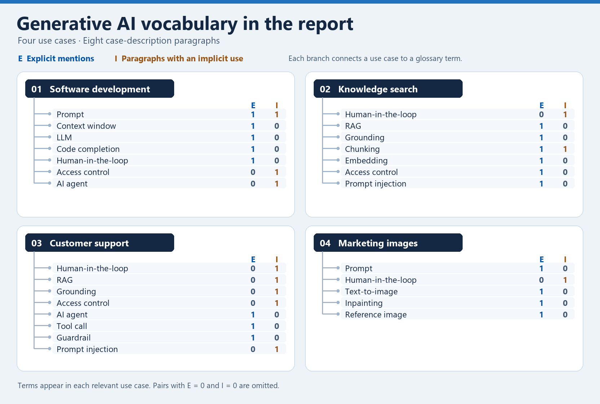

# Generative AI Vocabulary

These terms come from the four workflows in the [research report](research-report.md).

| Term | Meaning in practice |
| --- | --- |
| Prompt | Instructions or a question sent to the model, often with context and a description of the desired output. |
| Context window | The amount of text or other input a model can process in one request, usually measured in tokens. A long conversation or a large codebase may need to be trimmed before it fits. |
| Large language model (LLM) | A model trained on large collections of text to predict tokens. Given an input, it can use those learned patterns to generate text or code. |
| Code completion | A suggestion for code near the cursor that a developer can accept, edit, or discard. |
| Human-in-the-loop | A workflow in which a person can review a decision, approve an output, or take over an exceptional case. |
| Retrieval-augmented generation (RAG) | A workflow that looks up relevant material at request time and gives it to a model as context for its answer. |
| Grounding | Tying an output to evidence, such as a policy passage or a verified order record. Retrieved text only helps if it supports the actual claim. |
| Chunking | Splitting long documents into smaller passages so a search system can return the relevant section. Boundaries matter because a rule and its exceptions may need to travel together. |
| Embedding | A vector of numbers that represents an input such as a passage. Comparing the vectors can help find related text even when the words differ. |
| Access control | The checks that determine which data someone may see and which operations they may perform. The data service should enforce these checks. |
| AI agent | A system that uses a model to choose actions toward a goal, such as inspecting a file, editing it, and deciding what to test next. |
| Tool call | A request to a callable function or service with specific arguments. The application validates the request, runs the tool if allowed, and can pass the result back to the model. |
| Guardrail | A constraint or check that blocks, redirects, or requires approval for a risky input, output, or action. |
| Prompt injection | An attempt to make a model follow instructions embedded in untrusted input, such as a retrieved document or a customer message. |
| Text-to-image | Generation of a new image from a written description of what it should show. |
| Inpainting | Regeneration of a selected region of an existing image while keeping the surrounding content as context. |
| Reference image | A visual input used to steer an image generator toward a style, composition, or subject. |

## How usage was counted

The sample is the eight case-description paragraphs in the report. It excludes headings, the introduction, and implementation lists.

- **Explicit (E)** counts each case-insensitive match of a glossary term at word boundaries. Full forms and abbreviations count for LLM and RAG. A full form immediately followed by its abbreviation counts once. Longer phrases take precedence, so `prompt injection` contributes only to the count for that phrase.
- **Implicit (I)** counts one occurrence per term per paragraph when the paragraph describes the concept without using the term or its abbreviation. The annotations below identify the supporting text so the counts can be checked.

### Frequency by use case

| Term | 1. Software E/I | 2. Knowledge E/I | 3. Support E/I | 4. Images E/I | Total E/I |
| --- | ---: | ---: | ---: | ---: | ---: |
| Prompt | 1/1 | 0/0 | 0/0 | 1/0 | 2/1 |
| Context window | 1/0 | 0/0 | 0/0 | 0/0 | 1/0 |
| Large language model (LLM) | 1/0 | 0/0 | 0/0 | 0/0 | 1/0 |
| Code completion | 1/0 | 0/0 | 0/0 | 0/0 | 1/0 |
| Human-in-the-loop | 1/0 | 0/1 | 0/1 | 0/1 | 1/3 |
| Retrieval-augmented generation (RAG) | 0/0 | 1/0 | 0/1 | 0/0 | 1/1 |
| Grounding | 0/0 | 1/0 | 0/1 | 0/0 | 1/1 |
| Chunking | 0/0 | 1/1 | 0/0 | 0/0 | 1/1 |
| Embedding | 0/0 | 1/0 | 0/0 | 0/0 | 1/0 |
| Access control | 0/1 | 1/0 | 0/1 | 0/0 | 1/2 |
| AI agent | 0/1 | 0/0 | 1/0 | 0/0 | 1/1 |
| Tool call | 0/0 | 0/0 | 1/0 | 0/0 | 1/0 |
| Guardrail | 0/0 | 0/0 | 1/0 | 0/0 | 1/0 |
| Prompt injection | 0/0 | 1/0 | 0/1 | 0/0 | 1/1 |
| Text-to-image | 0/0 | 0/0 | 0/0 | 1/0 | 1/0 |
| Inpainting | 0/0 | 0/0 | 0/0 | 1/0 | 1/0 |
| Reference image | 0/0 | 0/0 | 0/0 | 1/0 | 1/0 |

### Evidence for implicit usage

| Case | Paragraph | Term | Excerpt from the report |
| --- | ---: | --- | --- |
| 1. Software development | 1 | Prompt | “a developer describes a missing validation rule” |
| 1. Software development | 1 | AI agent | “a coding assistant can inspect related files, draft a patch, and run a test” |
| 1. Software development | 2 | Access control | “Give the assistant access only to the repositories it needs” |
| 2. Knowledge search | 2 | Chunking | “a passage can be cut off before a crucial exception” |
| 2. Knowledge search | 2 | Human-in-the-loop | “route unanswered questions to the policy owner” |
| 3. Customer support | 1 | Retrieval-augmented generation (RAG) | “retrieves an approved help article and uses it to draft a reply” |
| 3. Customer support | 1 | Grounding | “uses it to draft a reply about delivery policy” |
| 3. Customer support | 2 | Prompt injection | “A malicious customer message might tell the agent to ignore those rules” |
| 3. Customer support | 2 | Access control | “enforce permissions in the service that owns the data” |
| 3. Customer support | 2 | Human-in-the-loop | “Route ambiguous or exceptional requests to a support specialist” |
| 4. Marketing images | 2 | Human-in-the-loop | “have a designer check brand fit, factual accuracy, and usage rights before release” |

### Relationship graph

