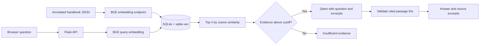

# Canal Works Handbook

Canal Works is a local question-and-answer tool for a fictional coworking space. It answers questions about building access, bookings, and shared services using a versioned handbook. Each answer links to the passages used, and the interface exposes vector matches and query timings for inspection.

[Watch the narrated demonstration](https://github.com/EclipseReign/genai-coursework/releases/download/module-3-rag-demo-v1/canal-works-rag-demo.mp4)

## Run locally

Tested on Windows x64 with Python 3.12, [llama.cpp b12442](https://github.com/ggml-org/llama.cpp/releases/tag/b12442), CPU embeddings, and Vulkan chat inference. CPU-only inference is also supported by llama.cpp. The model files take about 2.6 GB on disk and require no API key. The demo used a GTX 1650 with 4 GB of VRAM.

1. Unpack the llama.cpp build for your system and add its directory to your shell's path. On Windows the executable is `llama-server.exe`. On macOS, use a Python build with SQLite extension loading enabled.
2. Download the GGUF files to a local directory as `bge.gguf` and `qwen.gguf`.

   | File | Source | SHA-256 |
   | --- | --- | --- |
   | `bge.gguf` | [BGE small English v1.5 Q8](https://huggingface.co/ggml-org/bge-small-en-v1.5-Q8_0-GGUF/resolve/main/bge-small-en-v1.5-q8_0.gguf) | `f046db1dc724cf4f6f0a0c5917e922823b73eb1d27b8f9a9c2797f7866974804` |
   | `qwen.gguf` | [Qwen3 4B Instruct 2507 Q4_K_M](https://huggingface.co/bartowski/Qwen_Qwen3-4B-Instruct-2507-GGUF/resolve/main/Qwen_Qwen3-4B-Instruct-2507-Q4_K_M.gguf) | `2fde00ce69dd4899c70d020845e2638353015bba0fdf161b3eb965f2bca4464e` |

3. Start the two model endpoints in separate terminals from the directory containing the downloaded files. Keep both terminals running.

   ```sh
   llama-server -m bge.gguf --host 127.0.0.1 --port 8091 --alias bge-small-en-v1.5-q8 --embedding --pooling cls -c 2048 -b 512 -ub 512 -np 1 -t 4 -ngl 0
   ```

   ```sh
   llama-server -m qwen.gguf --host 127.0.0.1 --port 8092 --alias qwen3-4b-instruct-q4 -c 2048 -np 1 -t 4 -ngl 0
   ```

   For Vulkan acceleration, use the Vulkan build for the second command, list devices with `llama-server --list-devices`, and replace `-ngl 0` with `--device DEVICE -ngl 99`, substituting the reported device name. CPU generation can be slow. Both `/health` endpoints return `{"status":"ok"}` when ready.

4. From `module-3-rag/`, create a virtual environment and start the app. Use `.venv/bin/python` in place of `.venv/Scripts/python` on Linux or macOS.

   ```powershell
   python -m venv .venv
   .venv/Scripts/python -m pip install -r requirements.txt
   .venv/Scripts/python rag.py ingest
   .venv/Scripts/python app.py
   ```

5. Open [the local web app](http://127.0.0.1:8080/). Ask “Can I bring guests on Sunday as a Studio member, and when must I register them?” Expand the cited source to verify the deadline. Ask about member health insurance to see how the tool responds when the handbook lacks evidence.

## How it works



- **Dataset.** [Data files](data/) contain 15 policy passages across access, rooms, and services. All facilities, prices, and policies are synthetic. Each record has a stable ID, section title, topic, intended audience, effective date, and source text. The dataset includes close alternatives, such as weekday and weekend guest rules.
- **Chunking and ingestion.** One handbook section is one chunk. Each chunk keeps policy conditions and exceptions together. The CLI validates IDs, embeds titles and text in batches, checks vector shape, and rebuilds the index in one transaction. It records the embedding model and a SHA-256 corpus fingerprint. Re-run ingestion after source or embedding changes.
- **Retrieval.** The BGE model embeds the query with its retrieval prefix. SQLite runs a cosine nearest-neighbor query over 384-dimensional float vectors through `vec0`. The app retrieves four candidates and uses those with similarity ≥ 0.62 as LLM context. The threshold was selected using the included fixture queries and is specific to this model and dataset. Similarity measures relevance, rather than answer correctness.
- **Generation.** The chat client sends the original question and the selected passages through llama.cpp's chat endpoint. Qwen generates structured JSON. A short response appears only when citations refer to passages in the supplied context. Missing evidence or malformed output produces an explicit abstention.
- **Interface.** The browser displays the answer, expandable sources, and an optional ranked retrieval trace. The matching passages, similarity values, and timings are also available to API and CLI callers.

| Component | Repository artifact |
| --- | --- |
| Project design, requirements, and limitations | This README |
| Annotated source corpus | [data/](data/) |
| Local database and vector query | [rag.py](rag.py), SQLite schema and `retrieve` |
| Embedding client and validation | [rag.py](rag.py), `embed` |
| Database ingestion | [rag.py](rag.py), `ingest` |
| Chat client | [rag.py](rag.py), `generate` |
| Browser interface | [app.py](app.py) and [web/](web/) |
| End-to-end pipeline and evaluation | [rag.py](rag.py), `ask`, and [evaluate.py](evaluate.py) |
| Narrated demonstration | [GitHub release](https://github.com/EclipseReign/genai-coursework/releases/tag/module-3-rag-demo-v1) |

## Reproduce the checks

```powershell
.venv/Scripts/python rag.py search "Where can a wheelchair user get in without stairs?"
.venv/Scripts/python rag.py ask "How far in advance must I cancel a meeting room to get my credit back?"
.venv/Scripts/python evaluate.py --report .local/evaluation.json
```

The nine [evaluation cases](evaluation/cases.json) cover paraphrased queries, confusingly similar policies, composition across two passages, and three unsupported questions. The report checks whether the top four include all expected sources, whether cited IDs exactly match, and whether the reply contains the expected facts. It also records latency and checks abstention.

The [observed run](evaluation/observed-results.json) passed **9/9** cases. All expected passages appeared in the top four for **6/6** answerable queries, including the two-source query, and the app declined **3/3** unsupported queries. Restarting ingestion from the same corpus gave the same fingerprint and passage count.

## Limitations

The 15 passages and nine scripted queries are an integration benchmark for this fixture, with no independent test split. Cite-ID validation checks provenance and cannot prove that a sentence is entailed by its cited text. The app accepts single-turn questions in English. The small chat model can omit a condition or use an imprecise paraphrase, so inspect the original passage for exact policy. The index uses exact search suitable for a small corpus. Corpus changes require a rebuild. Flask's development server and the model endpoints are intended for local use on loopback.
